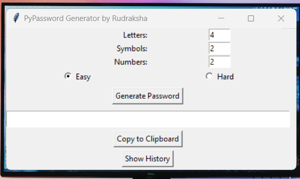
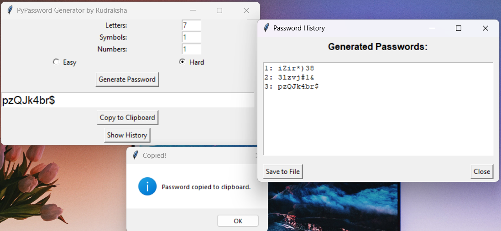

# 🔐 PyPassword Generator

[](https://www.python.org/)
[](https://docs.python.org/3/library/tkinter.html)
[](https://microsoft.com)
[](LICENSE)

A clean, user-friendly desktop application built with Python and Tkinter for generating highly customizable, secure passwords. Features multiple difficulty modes, instant clipboard copy, session history tracking, and text file export.

Developed by **Rudraksha**.

---

## 📸 Screenshots

| Main Interface | History & Export |
|:---:|:---:|
|  |  |

---

## ✨ Features

- **Customizable Composition**: Set precise counts for letters, numbers, and symbols.
- **Dual Difficulty Modes**:
  - **Easy**: Groups letters, symbols, and numbers in sequence.
  - **Hard**: Shuffles all selected characters randomly for maximum entropy.
- **One-Click Clipboard Copy**: Quickly copy the generated password to your clipboard.
- **Session Password History**: Review all passwords generated during your current session in a separate window.
- **Export to File**: Save your password history to a `.txt` file using the native file picker.
- **Input Validation**: Graceful error handling for empty or non-integer inputs.
- **Portable / Standalone Ready**: Can be run directly as a Python script or packaged into a standalone `.exe`.

---

## 📂 Project Structure

```text
PasswordGenerator/
├── media/
│   ├── image1.png          # Screenshot of main window
│   └── image2.png          # Screenshot of history & clipboard dialog
├── dist/
│   └── PWDgenerator.exe    # Pre-built standalone Windows executable
├── build/                  # PyInstaller build artifacts
├── main.py                 # Core application code (Tkinter GUI + logic)
├── PWDgenerator.spec       # PyInstaller specification file
└── README.md               # Project documentation
```

---

## 🚀 Getting Started

### Prerequisites

- **Python 3.8+** installed on your system.
- Tkinter comes pre-installed with standard Python distributions on Windows.

### Installation

1. **Clone the repository**:
   ```bash
   git clone https://github.com/<your-username>/PasswordGenerator.git
   cd PasswordGenerator
   ```

2. **Run the application**:
   ```bash
   python main.py
   ```

### ⚡ Running Without Python (Windows)

If you just want to run the pre-built desktop application without installing Python:
- Navigate to the `dist/` directory and run **`PWDgenerator.exe`**.

---

## 🛠️ How to Build Executable

To generate your own `.exe` using [PyInstaller](https://pyinstaller.org/):

1. Install PyInstaller:
   ```bash
   pip install pyinstaller
   ```

2. Build using the included `.spec` file:
   ```bash
   pyinstaller PWDgenerator.spec
   ```
   *The compiled binary will be placed inside the `dist/` folder.*

---

## 🎮 How to Use

1. Enter desired counts for:
   - **Letters** (A-Z, a-z)
   - **Symbols** (`!`, `#`, `$`, `%`, `&`, `(`, `)`, `*`, `+`)
   - **Numbers** (0-9)
2. Choose difficulty:
   - Select **Easy** for ordered grouping.
   - Select **Hard** for randomized character shuffle.
3. Click **Generate Password**.
4. Click **Copy to Clipboard** to use your new password immediately.
5. Click **Show History** to inspect previous passwords or click **Save to File** to export them as a `.txt` file.

---

## 📜 License

This project is open-source and available under the [MIT License](LICENSE).
